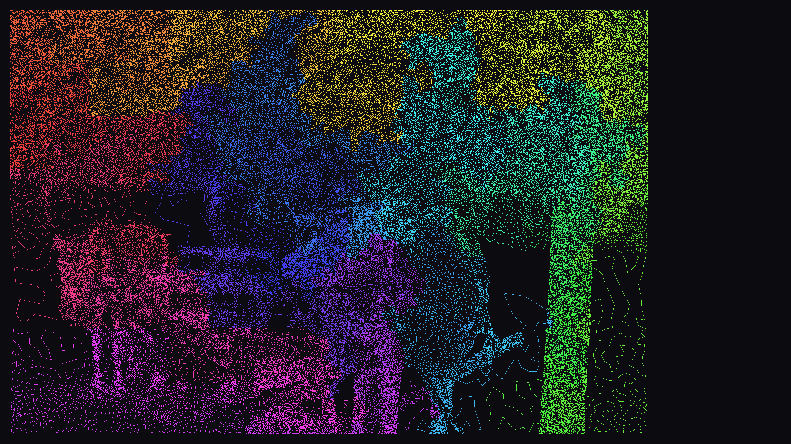
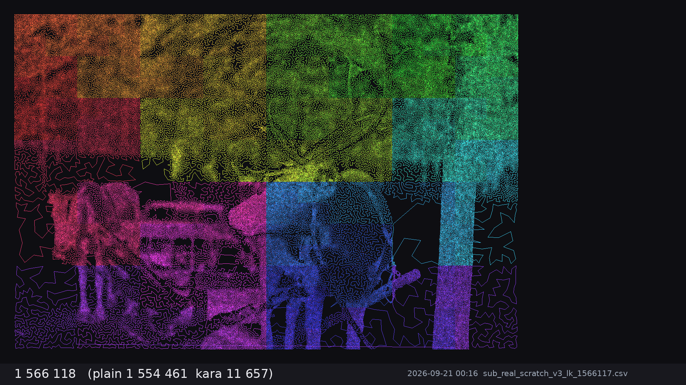
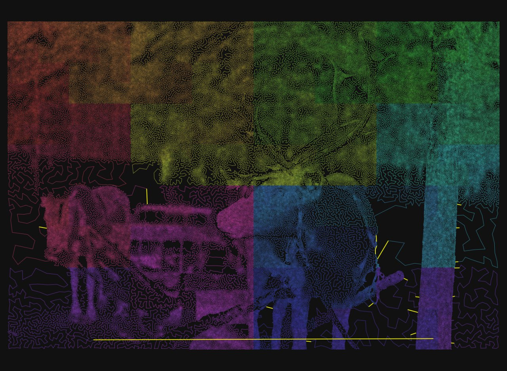
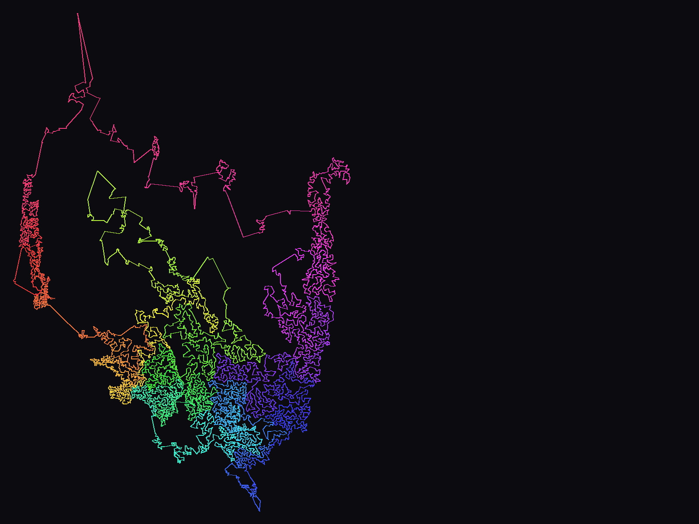
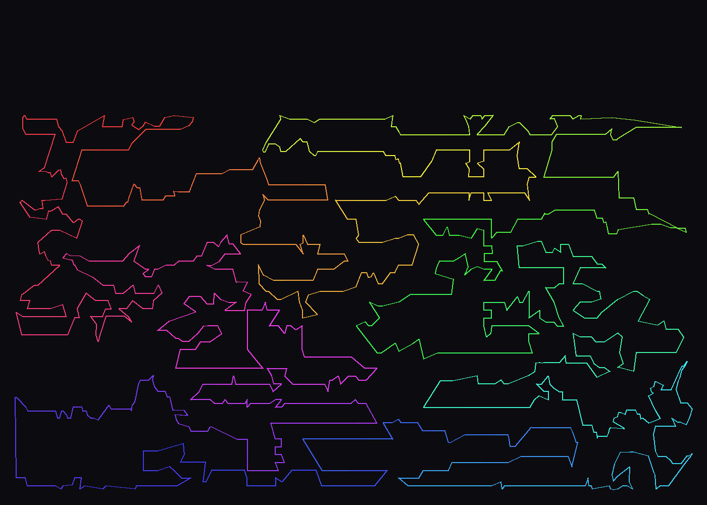
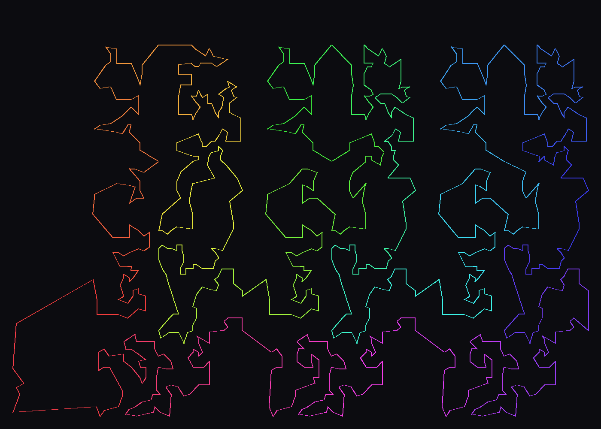
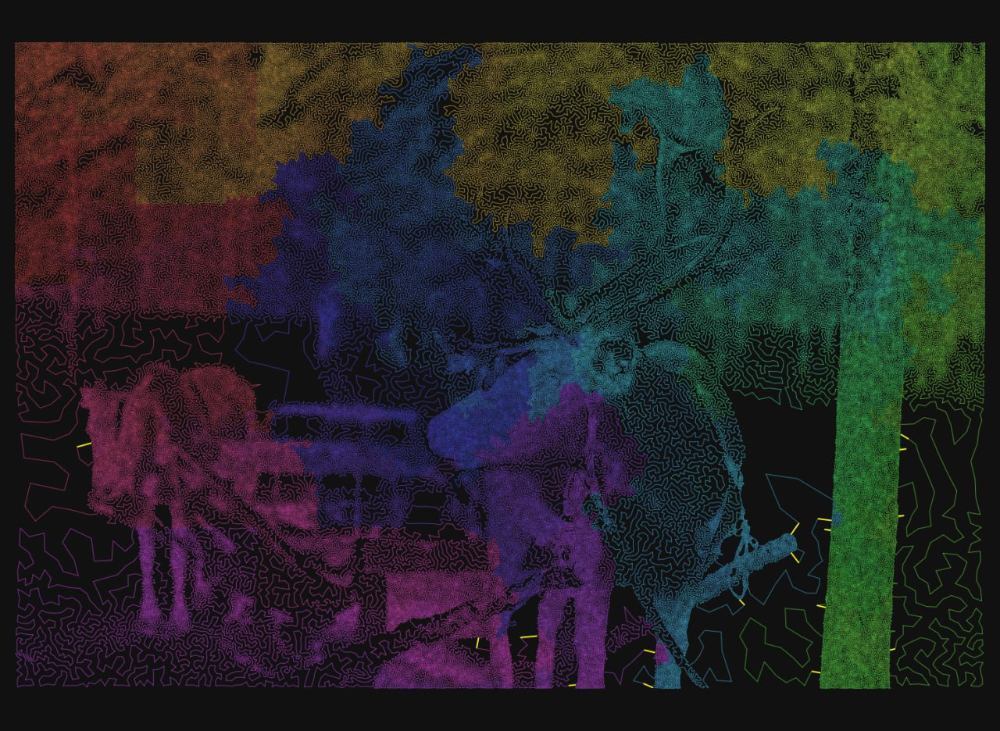

# TspSolver — GPU memetic TSP solver

A from-scratch TSP solver for one RTX 3090 (Numba/CUDA), built during a 7-day autonomous-agent experiment
(21–27 Sep 2026). Two problems, one code base:

- **Kaggle Traveling Santa 2018 — Prime Paths** (197 769 cities, 10 % penalty on every 10th step unless it starts
  from a prime city): **1 526 256** from scratch, without LKH or its "heart" (no Held–Karp α-candidates, no 5-opt).
- **TSPLIB** (41 instances, 52–9 882 cities): one entry point, parameters and budget scaled with n,
  **median gap 0.198 %** to the optimum.


*Santa 2018, final tour (colour = position along the tour). 197 769 cities, score 1 526 256.*

## Headline numbers

| Santa 2018 Prime Paths | score | our result vs |
|---|---|---|
| **this solver, from scratch, 7 days** | **1 526 256** | — |
| reference solution from a LinkedIn write-up (LKH-style pipeline, 9 days) | 1 529 000 | −2 744 |
| its benchmark: LKH tour with the penalty applied | 1 516 256 | +10 000 (0.66 %) |
| top of the Kaggle 2018 leaderboard | ≈1 512 000 | +14 256 (0.94 %) |
| from-scratch recipe, one script, 5 h (`scripts/santa_recipe_fast.sh`) | 1 527 835 | reproducible baseline |

TSPLIB (details in [docs/TSPLIB_RESULTS.md](docs/TSPLIB_RESULTS.md)): 41 instances, 16 within 0.1 %, 35 within 1 %,
worst 1.89 % (fnl4461); every instance beats the previous solver in this repository, usually several-fold
(pr1002 0.20 % vs 1.19 %, pcb1173 0.16 % vs 2.05 %, rl1889 0.32 % vs 1.96 %, gr9882 1.01 % vs 3.57 %).

## Pictures

| | |
|---|---|
|  |  |
| Day 1: Hilbert curve start after local search (1 566 117). The long seam edge and the "filaments" are still there. | Day 3: the operator's eye. Green and violet threads cross each other all over the map — none of the window-based operators could see it. This picture led to `uncross` (2-opt between arbitrarily distant edges, evaluated *without* the penalty and repaired afterwards): −7 000 on the greedy tour in 4 minutes. |
|  |  |
| gr9882 (Greece, 9 882 cities): 303 930, 1.01 % above the optimum. Islands and coasts are where "excursion merge" and "landmass" starts came from. | rl1889 (1 889 cities): 317 552, 0.32 %, population mode + LK/or-opt polish, 21 min. |
|  |  |
| pr1002: 259 558, 0.20 %, 11 min. | A tour drawn through an image (the art-TSP experiments this project grew out of). |

**Video — the Santa record over the 7 days:** [youtu.be/4v6lGGsZwS4](https://youtu.be/4v6lGGsZwS4)
(one frame per record improvement, Hilbert curve 1 842 660 → 1 526 256; frames rendered by `scripts/frames.py`,
source file [images/santa_progress.mp4](images/santa_progress.mp4)).

**Carousel (Polish, for the LinkedIn post):** [docs/santa_2018_agent_7_dni.pdf](docs/santa_2018_agent_7_dni.pdf)
(15 pages: curve, gates, operators, what failed, TSPLIB, recipe, conclusions; built by `docs/carousel/build.py`).

[](https://youtu.be/4v6lGGsZwS4)

## How it works

**Santa (large instances, "fragments" mode).** One tour on the GPU, one thread per position for move evaluation,
batches of non-conflicting moves applied on the CPU (Numba). The penalty depends on the *position* in the tour, so
every move is priced exactly on the affected range; the search alternates between a *relaxed* penalty (0) and the
*full* penalty ("look as if there were no penalty, then return to the full price; the best tour is always stored at
the true price"). Operators, in the order they entered the recipe:

| operator | file | what it does |
|---|---|---|
| LS | `gpu_ls.py` | Or-opt (L≤3, both orientations), penalty-neutral blocks of 10/20/30, 2-opt in a window, swap, prime-slot fill |
| LK chain | `gpu_lk.py` | Lin–Kernighan chain from a fixed t1: sequence of 2-opt steps **and or-opt steps** (segment 1–3 moved behind t3), DFS 8×5×3, depth 5, per-thread copy of a window (3000–5000 positions), exact penalty on the range |
| frag | `gpu_frag.py` | the tour cut into fragments of 128 positions with frozen ends; one CUDA block per fragment runs a mini-ILS (double-bridge kicks + 2-opt/Or-opt) in shared memory; four shifted partitions per pass |
| xswap2 | `gpu_xswap2.py` | exchange a city of segment A for a city of segment B anywhere in the tour, each inserted at its best place within ±D |
| orlong | `orlong.py` | Or-opt of long segments (3…5000) without a distance limit; O(1) penalty delta via prefix sums by position mod 10 |
| uncross | `uncross.py` | 2-opt between crossing edges arbitrarily far apart in the tour (kd-tree along the edge), evaluated without the penalty |
| excursion merge | `orlong.py` | two "excursions" to the same region (each with its own long edges) merged into one; full scan of insertion points |
| ILS | `ils.py` | double-bridge kicks in ~200 windows, local acceptance per window, stall-stop |
| DP windows | `gpu_dp.py` | exact Held–Karp on windows of 12–16 positions (kept for small instances only) |
| alpha candidates | `alpha.py` | candidate lists from a 1-tree (MST + LCA), no subgradient π |
| starts | `baseline.py`, `celltour.py`, `landmass.py` | Hilbert / Moore curves, greedy-edge + long-edge 2-opt + uncross, Karp cells, density "landmasses" |
| recombination | `gpx.py`, `ox.py` | partition crossover with exact penalty; order crossover with CPU repair |

**TSPLIB (small and mid-size instances, "population" mode).** `domains/tsp/kernel.py` is a population memetic
algorithm on the GPU (islands of 4 individuals, 2048–8192 islands, OX crossover, colonies with migration, tabu on tour
lengths, a "ladder" of operators with rollouts). `solve.py` runs it for n ≤ 5000, then polishes the best islands with the
LK/or-opt chain above (`--hybrid`), and switches to the fragments pipeline above 5000.

**Process.** Short runs, plateau = stop, every hypothesis measured by a *gate*: 10 min × 3 seeds from the same start,
median, threshold ≈ 3× spread; a configuration bandit for the night runs; a journal entry every 12 h. The journal with
every number, decision and mishap is in [docs/JOURNAL.md](docs/JOURNAL.md); the measured from-scratch recipe in
[docs/RECIPE.md](docs/RECIPE.md).

## Results and timings

- Santa: the 7-day curve (from scratch): Hilbert 1 842 660 → LS 1 590 816 (day 1) → LS+LK 1 576 303 → ILS 1 566 117
  → chained LK 1 550 414 → gates 1 545 839 (day 2) → frag 1 541 244 → xswap2/orlong 1 538 779 → uncross without penalty
  1 532 713 → relaxed penalty 0 + repair 1 528 697 (day 4) → or-opt in the LK chain 1 527 422 (day 5) → LK window 5000
  **1 526 256** (day 7). Tour: `results/santa/santa_1526256.csv` (Kaggle submission format).
- TSPLIB: `results/universal.jsonl` (one JSON line per run: length in the TSPLIB metric, optimum, gap, wall time, mode,
  parameters), best tour per instance in `results/tours/`, sweep logs in `results/sweep*.log`, table in
  `docs/TSPLIB_RESULTS.md`. A regression sweep after the English-only refactor reproduced the results on the
  instances above 1000 cities: fragment/deterministic runs bit for bit, population runs within run-to-run noise
  (`results/sweep_gt1000.log`).

## Running it

```
# environment: Python 3.12, numba + CUDA (cudashim), numpy, scipy, pillow (frames); see requirements.txt
export PYTHONPATH=$PWD CUDA_HOME=$HOME/cudashim

# any TSPLIB instance from instances/tsplib (parameters and budget from n):
python domains/santa/solve.py pr1002                 # population + LK polish, ~10 min
python domains/santa/solve.py rl5934                 # fragments, ~40 min
python domains/santa/solve.py gr9882 --budget 3600   # override the time budget

# Santa 2018 from scratch, one script (~5 h on an RTX 3090):
bash scripts/santa_recipe_fast.sh

# single run with explicit operators (see run.py --help):
python domains/santa/run.py --start greedy --pen 0.0 --lk 3 --lk-oropt --lk-W 5000 --frag 100 --xswap2 20 \
    --orlong 3 --uncross 300 --excursion 6 --ils 1000000 --ils-time 14400 --tag demo

# gates, bandit, dashboard, tour viewer:
python domains/santa/bench.py --start <tour.csv> --budget 600 --seeds 1,2,3 --tag A -- <run.py args>
python domains/santa/bandit.py --start <tour.csv> --arms arms.json --rollout 300 --play 3600
python domains/santa/web.py 8902            # live dashboard + journal
python domains/santa/tour_view.py <tour.csv> out.html [instance.csv]   # pan/zoom view of a whole tour
```

Paths: the scripts default to `~/santa/data` (Santa `cities.csv`), `~/santa/results` and `instances/`; `solve.py`
converts TSPLIB files to CSV on first use. Tests: the `test_*` functions in `domains/santa/test_santa.py` (run each in
its own process when the GPU is shared).

## Repository layout

```
domains/santa/   solver, operators, starts, ILS, gates, bandit, dashboard, viewer, tests
domains/tsp/     population memetic GPU kernel (islands, OX, colonies, ladder) used for n <= 5000
engine/          GPU helpers (PRNG)
scripts/         recipes (from scratch), sweeps, frames/animation, result tables
docs/            JOURNAL.md (7 days, 16 entries), RECIPE.md, TSPLIB_RESULTS.md
results/         universal.jsonl, sweep logs, best tours (TSPLIB), Santa submission
instances/       TSPLIB instances used here, Santa cities.csv
images/          renders used above, santa_progress.mp4
```

## What did not work (measured)

DP windows combined with frag; equal-length segment exchange; negative penalty (undecided); GPX between tours of
different starts (0 matching segments); OX as a breakthrough (child reaches parents' level); injecting LK-optimal
tours into the population mid-evolution (kick / worst variants lose diversity); macro-TSP over segments;
density-adaptive Moore curve. Details and numbers in the journal.

## Provenance

Built by an autonomous coding agent (Claude Fable 5.1) with a human in the loop for direction and the "operator's
eye" (tour pictures). The "previous solver" column in the TSPLIB table cites the 2025 CPU/GPU solver this project
started from; its code is not part of this repository.
